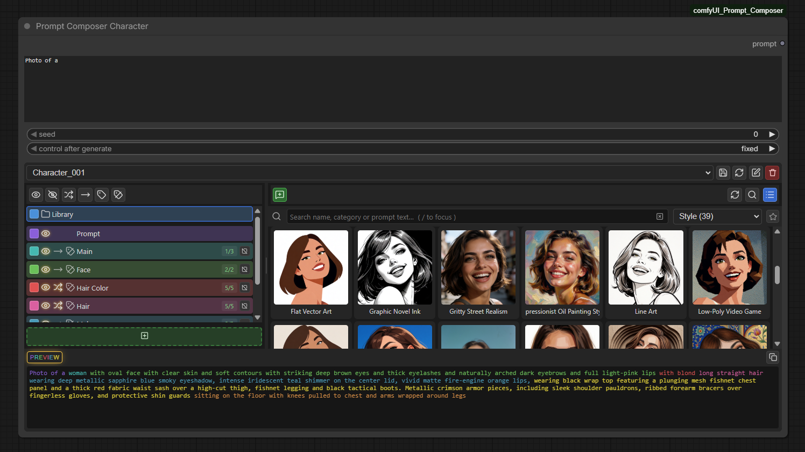
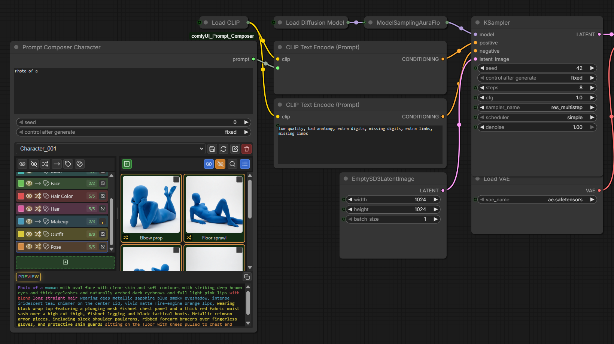
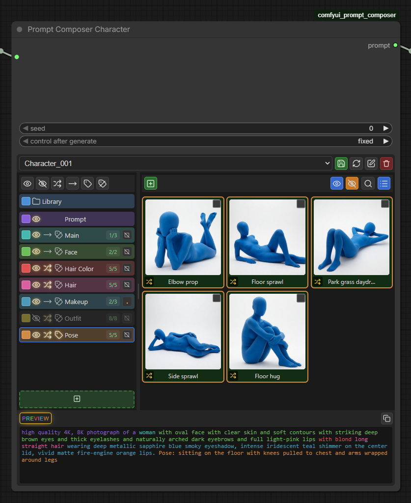
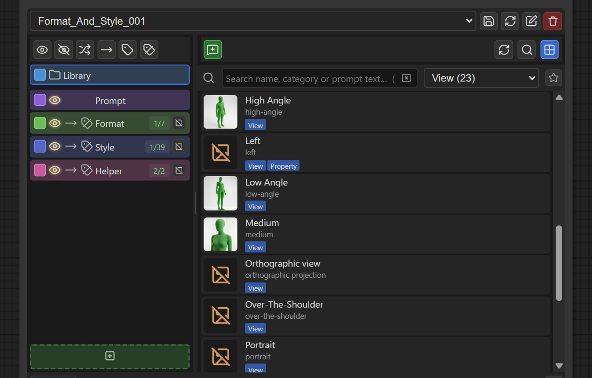
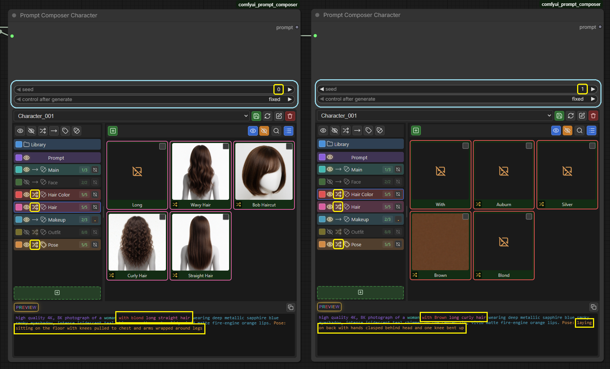
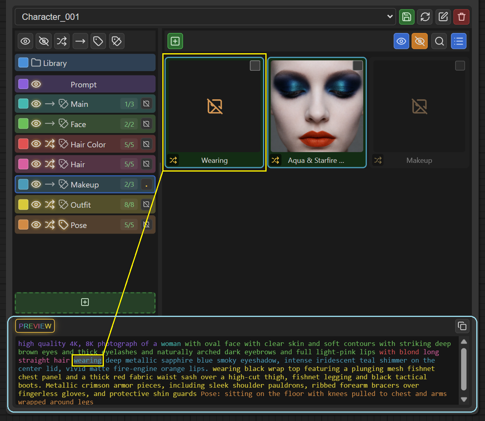
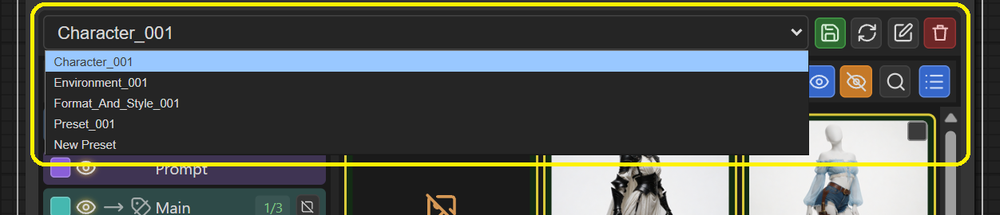
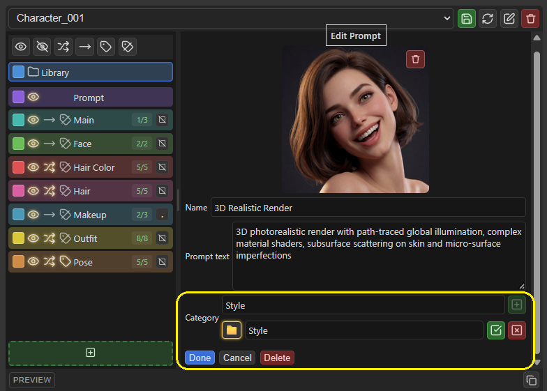
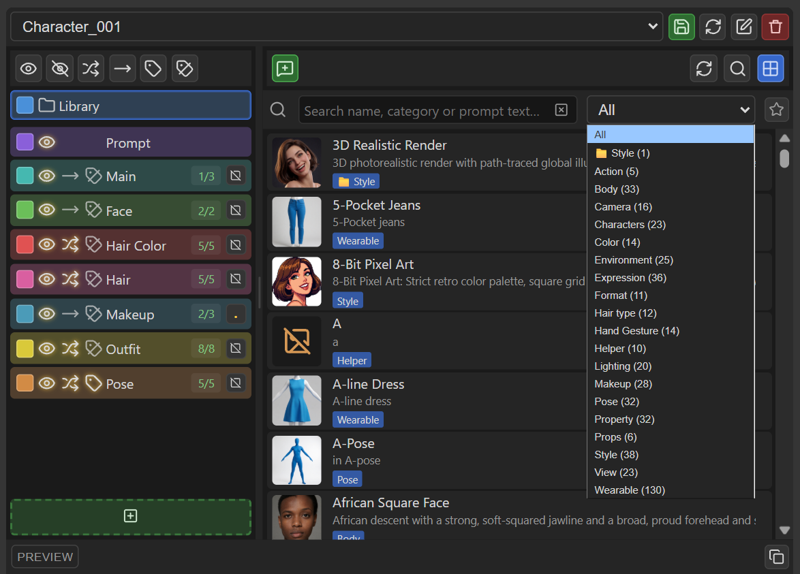
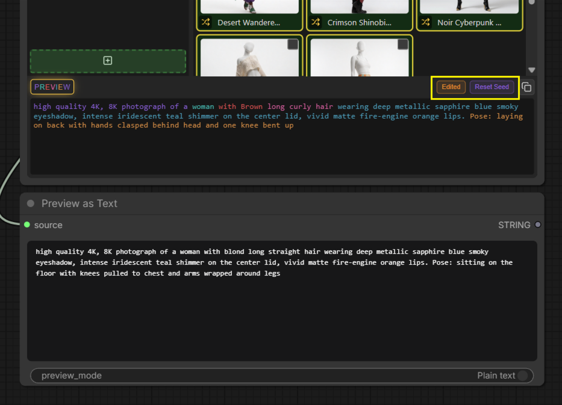

# Prompt Composer — A Visual Prompt Library & Composition System for ComfyUI

Build complex prompts from reusable pieces instead of rewriting them every time.

**Prompt Composer** lets you create a visual library of prompt snippets—characters, outfits, expressions, styles, lighting, environments, camera settings, and more—and combine them into organized sections directly inside ComfyUI. Keep parts fixed, randomize selected sections with reproducible seeds, preview the final prompt, and save compositions for later use.



[Installation](#installation) · [Quick Start](#quick-start) · [Features](#features) · [Example Workflow](#example-workflow) · [Known Issues and Limitations](#known-issues-and-limitations) · [Feedback](#feedback-and-contributions)

---

## At a Glance

- **Build visually:** Organize prompt components into sections and entries instead of managing one long text field.
- **Reuse your library:** Keep prompt snippets in portable files and organize them with folders, categories, and favorites.
- **Control randomization:** Randomize selected sections while keeping other sections fixed. Use seeds to reproduce a composition.
- **Preview before generating:** Inspect the composed prompt and understand which parts contribute to it.
- **Save compositions:** Reuse presets and save workflows with a snapshot of the composition.

## Why Prompt Composer?

Prompts often contain reusable building blocks: a subject, outfit, pose, lighting setup, art style, environment, and camera language. Rewriting or manually maintaining those pieces across many workflows can become repetitive.

Prompt Composer gives those pieces a visual home. Build a reusable library, combine entries into named sections, decide which parts stay fixed and which change, and inspect the result before generation.

## Installation

### Option 1: ComfyUI-Manager

1. Open ComfyUI-Manager.
2. Search for **Prompt Composer**.
3. Install the node if it is listed.
4. Restart ComfyUI.

If Prompt Composer is not available in your Manager version, use the manual method below.

### Option 2: Manual Installation

Open a terminal in your ComfyUI installation and run:

```bash
cd ComfyUI/custom_nodes
git clone https://github.com/d3vamin/comfyui_prompt_composer.git
```

Restart ComfyUI after installation.

To update an existing Git installation:

```bash
cd ComfyUI/custom_nodes/comfyui_prompt_composer
git pull
```

Restart ComfyUI after updating.

### Requirements

- A recent ComfyUI installation.
- Python 3.10 or newer.
- Pillow.

If installation fails, please open an issue and include the relevant ComfyUI console output and environment details.

## Quick Start

1. Install Prompt Composer and restart ComfyUI.
2. Add the Prompt Composer node to your workflow.
3. Create or add entries to your prompt library.
4. Arrange entries into sections—for example, subject, appearance, style, lighting, and environment.
5. Choose which sections should stay fixed and which should be randomized.
6. Inspect the composed prompt and run your workflow.



## Features

### 1. Compose Prompts from Sections and Entries

Break a prompt into meaningful parts and arrange those parts in the order you want.

- Add, reorder, enable, and disable sections.
- Give sections colors to make a composition easier to scan.
- Configure separators and section-label visibility.
- Add, reorder, duplicate, replace, show, or hide entries.
- Keep the permanent **Prompt** section for free-typed prompt text.
- Search within sections and use bulk actions where supported.



### 2. Build a Visual, Portable Prompt Library

Store reusable prompt components as files rather than keeping everything inside a single workflow.

- Save prompt text as text files.
- Save prompts with thumbnails as PNG files.
- Organize items into folders.
- Use categories and favorites to find entries.
- Search the library and preview thumbnails.
- Reuse library entries across compositions.

PNG library items can carry a small one-node workflow, so they can be dragged back onto the ComfyUI canvas when appropriate. This makes library items easier to move and reuse.



### 3. Randomize with Control

Explore prompt combinations without rebuilding the whole prompt each time.

- Randomize selected sections while leaving other sections fixed.
- Use seeds to make randomized selections reproducible.
- Reuse a seed to return to a composition.
- Inspect seed-related status indicators and reset a seed when you want a new result.



### 4. Preview the Final Prompt

Review the composition before it reaches the rest of your workflow.

- View the composed prompt.
- Use color cues to understand which sections contribute to the result.
- Inspect the prompt content before generation.
- Find related entry by clicking in the preview.



### 5. Save and Reuse Compositions

Keep useful arrangements so you can return to them later.

- Save and load presets for composition structures.
- Save workflows with a snapshot of the composition.
- Preserve useful fallback prompt text where supported, so a saved workflow remains understandable if a referenced library item is unavailable.
- Work with virtual presets where appropriate.



### 6. Organize Large Libraries

Keep growing collections manageable.

- Use folders, categories, and favorites.
- Search the library and preview larger images.
- Identify broken references when library items are missing.
- Switch between grid and list views when supported.




### 7. Track What Actually Ran

Prompt Composer includes indicators to help distinguish the composition used in the previous run from edits made afterward. Seed-related status indicators help you understand and restore the seed used for the previous execution.



## Example Workflow

A useful first example is a **character variation workflow**:

1. Keep the character identity and core subject description fixed.
2. Put clothing, expression, pose, lighting, and environment into separate sections.
3. Randomize only the sections you want to explore.
4. Reuse a seed when you want to reproduce a particular combination.
5. Send the composed prompt to your normal text-encoding and image-generation nodes.

[`Downloadable example workflow.json`](workflows/PromptComposer_Chain.json)

---

## Known Issues and Limitations

Please keep these limitations in mind:

- Library thumbnails are resized and center-cropped to 256 × 256.
- Thumbnail images have minimum and maximum dimension limits, and files over the supported size limit may be rejected.
- Image metadata is stripped when thumbnails are processed.
- Prompt names are limited to 128 characters.
- Presets are limited to 5 MB.
- Deleting a prompt does not currently warn if another composition references it.
- Randomized preview updates may have a slight delay.
- Invalid filename characters are replaced with spaces.
- The permanent **Prompt** section cannot be deleted, renamed, or independently disabled.
- **Known issue:** Panel scrolling in Node2 mode may not work properly.

If you encounter a problem, check the open issues before creating a new report.

## Feedback and Contributions

Feedback helps identify what should be improved next.

- **Report a bug:** [Open a GitHub issue](https://github.com/d3vamin/comfyui_prompt_composer/issues)
- **Request a feature:** [Open a GitHub issue](https://github.com/d3vamin/comfyui_prompt_composer/issues)
- **Browse the source:** [GitHub repository](https://github.com/d3vamin/comfyui_prompt_composer)

When reporting a bug, please include:

- Your ComfyUI installation method and version, if known.
- Your operating system and Python version.
- Steps to reproduce the issue.
- Relevant console errors or screenshots.
- A minimal workflow or example library item when it helps reproduce the problem.

## License

Prompt Composer is released under the **GNU General Public License v3.0**. See [`LICENSE`](LICENSE) for the full license text.
